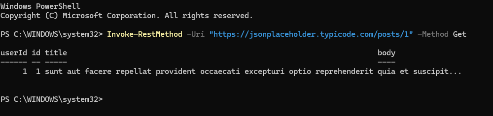
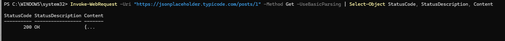

Lab 1: REST API Troubleshooting with PowerShell

Objective

Practice sending an HTTP GET request to a public REST API, retrieving JSON data, and interpreting HTTP response status codes.

Tools

Windows PowerShell

JSONPlaceholder public practice API

Test Endpoint

https://jsonplaceholder.typicode.com/posts/1

Test 1: Retrieve API Data

Invoke-RestMethod -Uri "https://jsonplaceholder.typicode.com/posts/1" -Method Get

Result: Successfully retrieved structured data containing userId, id, title, and body.

## Screenshot

### Successful REST API GET Request

Test 2: Inspect HTTP Response

Invoke-WebRequest -Uri "https://jsonplaceholder.typicode.com/posts/1" -Method Get -UseBasicParsing | Select-Object StatusCode, StatusDescription, Content

Observed result:

HTTP status: 200 OK

Response content: JSON

## Screenshot

### HTTP 200 OK Response

Troubleshooting Observations

Initially attempted API testing using Postman. The Cloud Agent failed to send requests, and the Desktop Agent experienced request timeouts.

The public API was accessible through Chrome, helping establish that the endpoint was reachable through the browser.

Switched to PowerShell to continue the REST API investigation without depending on Postman's connection.

During PowerShell testing, encountered a script execution warning from Invoke-WebRequest. Resolved the warning by using -UseBasicParsing.

Key Takeaways

A GET request retrieves data from an API.

HTTP 200 OK indicates a successful request.

JSON provides structured response data.

A connection timeout is different from an HTTP error response.

Alternative tools can help isolate problems and continue technical investigations.

Next Steps

Practice additional HTTP response scenarios.

Investigate network requests using browser developer tools.

Revisit Postman for hands-on API testing once its connection issues are resolved.

