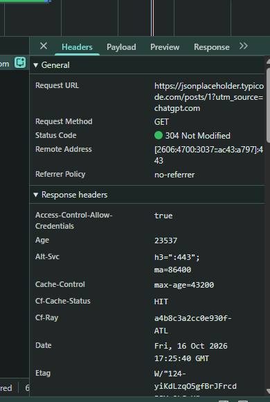
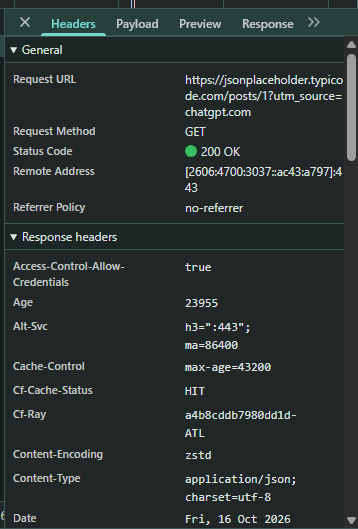
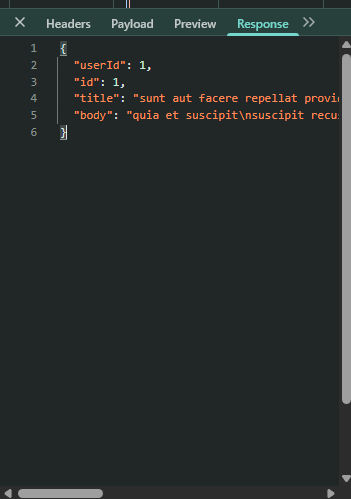

# Lab 2: HTTP Request Investigation Using Chrome DevTools

## Objective

Investigate HTTP network requests using Chrome Developer Tools, inspect request and response information, interpret HTTP status codes, and understand browser caching behavior.

## Tools

- Google Chrome
- Chrome Developer Tools (Network tab)
- JSONPlaceholder public REST API

## Test Endpoint

`https://jsonplaceholder.typicode.com/posts/1`

## Investigation 1: Inspecting an HTTP GET Request

Opened the test API in Chrome, launched Developer Tools, selected the Network tab, and reloaded the page.

Identified the API request and examined the following information:

| Field | Observed Result |
|---|---|
| Request Method | GET |
| Initial Status Code | 304 Not Modified |
| Subsequent Status Code | 200 OK |
| Response Content-Type | application/json; charset=utf-8 |

## Investigation 2: HTTP 304 and Browser Caching

**Observation:** The initial API request returned `304 Not Modified`.

**Analysis:** A 304 response indicates that the server determined the resource had not changed and the browser could reuse a previously cached representation.

**Troubleshooting action:** Enabled the "Disable cache" option in Chrome Developer Tools and reloaded the page.

**Result:** The request returned `200 OK`, and the JSON response was available.

The response headers also showed `CF-Cache-Status: HIT`, indicating that Cloudflare served a cached response. Browser caching and CDN caching are separate mechanisms.

## Investigation 3: JSON Response Inspection

Opened the Response tab and inspected the JSON data.

The response contained the following fields:

- `userId`: Identifies the user associated with the sample post.
- `id`: Identifies the post.
- `title`: Contains the post title.
- `body`: Contains the post content.

## Technical Support Takeaways

- Browser Developer Tools can help investigate API requests and responses.
- HTTP status codes provide evidence about request outcomes.
- A 304 response is not necessarily an application error.
- Disabling browser caching can help distinguish cached responses from fresh HTTP responses.
- JSON responses contain structured data useful for technical investigations.

## Next Steps

- Investigate simulated webhook delivery failures.
- Practice diagnosing authentication and server errors.
- Apply a structured troubleshooting workflow to SaaS integration scenarios.

## Screenshots

### HTTP 304 Not Modified

### HTTP 200 OK

### JSON Response

